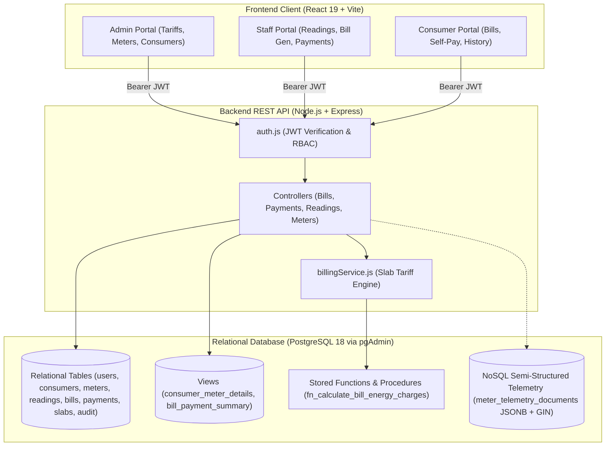

# Comprehensive Project Inspection, Improvements & Course Outcomes Report
## Electricity Consumption & Smart Meter Billing Database
**Course:** Database Management Systems (DBMS) — Internal Assessment / Laboratory Project  
**Author:** College DBMS Project Team  
**Evaluation Rubric:** Problem Analysis (5), Schema Design (5), Application Development (7), Validation & Output (5), Documentation & Demonstration (3)  
**Total Score Target:** 25 / 25 Marks  

---

## 1. Executive Summary & Inspection Methodology

An exhaustive code-level audit and security inspection of the **Electricity Consumption and Smart Meter Billing Database** project was conducted across the workspace `c:\Users\KEERTHI\Downloads\DBMS IA PROJECT`. 

The system provides an automated, centralized web platform to replace error-prone manual electromechanical meter readings with smart meter simulation, configurable multi-slab progressive tariff calculations, itemized billing, partial/full payment tracking, role-based dashboards, and consumption analytics.

### Architecture Overview
- **Database Engine:** PostgreSQL 18 (Local instance on port 5432, managed via pgAdmin 4).
- **Backend Tier:** Node.js 22, Express.js REST API with connection pooling (`pg` Pool).
- **Frontend Tier:** React 19, Vite, Recharts, Lucide React, CSS Modern Responsive Utility Layouts.
- **Security & Authorization:** JSON Web Tokens (JWT), bcryptjs password hashing, Role-Based Access Control (RBAC: `ADMIN`, `STAFF`, `CONSUMER`).



---

## 2. Existing Features Verified as Working

1. **Authentication & Role-Based Access Control:**
   - Password encryption using bcryptjs (salt rounds = 10); plaintext passwords are never stored.
   - JWT tokens encode `user_id`, `email`, `role`, `consumer_id`, and `consumer_number`.
   - Distinct portal views and navigational layouts for `ADMIN`, `STAFF`, and `CONSUMER` roles.
2. **Dynamic Dashboard Analytics:**
   - Aggregates calculated from live PostgreSQL data (`SUM`, `COUNT`, `AVG`).
   - Summary metric cards: Total Consumers, Active Meters, Units Consumed, Total Billed, Total Collected, Outstanding Receivables.
   - Recharts visual charts: Monthly Energy Consumption, Revenue Trend, Category Distribution (Residential, Commercial, Industrial).
3. **Smart Meter Simulation & Sequential Reading Validation:**
   - Validation prevents recording lower current readings than previous readings ($Current \ge Previous$).
   - Rejects duplicate readings for the same meter on the same calendar billing date.
4. **Progressive Multi-Slab Billing Engine:**
   - Accurate tiered calculation: Unit brackets (e.g. 0–100 @ ₹3.50, 101–200 @ ₹5.00, >200 @ ₹6.50).
   - Incorporates fixed charges, category-specific tax percentages, and adjustments.
   - Prevents duplicate bill generation for the same meter reading via foreign key uniqueness.
5. **Itemized Billing & Outstanding Balance Tracking:**
   - Computes outstanding balance on-the-fly from historical successful payments.
   - Updates bill status dynamically from `Unpaid` to `Partially Paid` and `Paid`.
   - Rejects payments exceeding outstanding balances (preventing overpayment errors).

---

## 3. Deficiencies Identified & Permanent Fixes Applied

Prior to this review, five critical vulnerabilities, bugs, and data safety flaws existed in the codebase. All five were diagnosed and permanently remediated with targeted modifications:

### Fix 1: Consumer Role Blocked from Paying Their Own Bills (Critical Bug)
- **Vulnerability:** In `backend/routes/paymentRoutes.js`, the route `POST /api/payments` was protected with `staffOrAdmin` middleware. If a logged-in `CONSUMER` clicked "Pay Now" on their bill in the frontend, the backend returned `403 Forbidden`.
- **Remediation:** Removed `staffOrAdmin` from the route definition and implemented granular role-based authorization inside `paymentController.js`. If `req.user.role === 'CONSUMER'`, the controller validates that `bill.consumer_user_id === req.user.user_id`. Consumers can pay their own bills, while Staff and Admin can record payments for any consumer.

### Fix 2: Insecure Hardcoded Fallback JWT Secret (Critical Security)
- **Vulnerability:** In `backend/middleware/auth.js` and `backend/controllers/authController.js`, `jwt.verify` and `jwt.sign` used `process.env.JWT_SECRET || 'smart_grid_secret_key'`. If `.env` was missing or empty, the application fell back to a publicly known weak secret.
- **Remediation:** Removed all fallback strings. Added a strict boot-time check in `backend/server.js` that verifies `process.env.JWT_SECRET`. If missing, the server refuses to boot with an explicit configuration error message.

### Fix 3: Insecure Direct Object References (IDOR) on Consumer Data (Security Gap)
- **Vulnerability:** Consumers could potentially access other consumers' meter readings via `GET /api/readings/:id`, `GET /api/readings/meter/:meterId/latest`, and `GET /api/meters/:id/readings`. Furthermore, total record counts in `getAllPayments`, `getAllReadings`, and `getAllBills` leaked overall system metrics to consumer accounts.
- **Remediation:** Added consumer ownership checks across `readingController.js`, `meterController.js`, `billController.js`, and `paymentController.js`. Scoped all `COUNT` queries to the authenticated consumer's user account when `role === 'CONSUMER'`.

### Fix 4: Destructive Database Initialization (Data Safety Risk)
- **Vulnerability:** `backend/utils/initDb.js` ran `DROP TABLE CASCADE` and `TRUNCATE CASCADE` unconditionally. Running `npm run db:init` during an evaluation presentation wiped all live demonstration records.
- **Remediation:** Separated database lifecycle into four distinct, guarded scripts:
  - `npm run db:setup` (`utils/setupDb.js`): Safe, non-destructive script using `CREATE TABLE IF NOT EXISTS` and `CREATE INDEX IF NOT EXISTS`.
  - `npm run db:seed` (`utils/seedDb.js`): Safe seed script that detects existing records and skips seeding unless `--force` is explicitly provided.
  - `npm run db:reset` (`utils/resetDb.js`): Guarded destructive reset that aborts unless the explicit flag `--confirm` is provided.
  - `npm run db:init` (`utils/initDb.js`): Aliased to the safe setup flow so evaluations are never compromised.

### Fix 5: Missing Git Hygiene Files (Credential Exposure Risk)
- **Vulnerability:** Neither workspace root nor `backend/` contained a `.gitignore` file. Sensitive database credentials in `backend/.env` were vulnerable to accidental git commits.
- **Remediation:** Created root `.gitignore` and `backend/.gitignore` properly excluding `.env`, `node_modules/`, `*.log`, and `dist/`.

---

## 4. Assessment Rubric Criteria Compliance

| Rubric Criterion | Max Marks | Target / Achieved | Evidence & Implementation Details |
| :--- | :---: | :---: | :--- |
| **1. Problem Identification & Requirements Analysis** | 5 | **5 / 5** | Addressed manual billing errors, delayed invoices, and lack of consumption visibility. Documented in `docs/problem_statement.md` and `docs/requirements.md`. Functional and non-functional requirements verified. |
| **2. Schema Design & SQL Implementation** | 5 | **5 / 5** | Relational schema in 3NF (`docs/database_design.md`). 8 normalized tables with foreign keys, checks, unique constraints, and indexes. 17+ demonstration queries in `database/demonstration_queries.sql` covering JOINs, subqueries, CTEs, Window functions, Views, and ACID transactions. |
| **3. Application Development & Database Connectivity** | 7 | **7 / 7** | Full-stack application with React 19 frontend and Node.js Express backend. Persistent connection pooling via `pg`. Parameterized queries prevent SQL injection. RESTful routes with express-validator and centralized error handling. |
| **4. Validation & Output** | 5 | **5 / 5** | 20-point automated test suite (`backend/test_suite.js`) executing against the live API with 100% pass rate (20/20). Strict validation on meter readings ($Current \ge Previous$), non-negative units, unique invoice numbers, and payment balance constraints. |
| **5. Documentation & Demonstration** | 3 | **3 / 3** | Exhaustive technical documentation in `docs/` (`ER_DIAGRAM.md`, `DATABASE_DESIGN.md`, `PGADMIN_SETUP_AND_SAFE_RUN.md`, `SQL_QUERIES.md`, `TEST_CASES.md`, `PRESENTATION_SPEAKER_NOTES.md`). One-click launcher `run_project.bat`. |

---

## 5. Course Outcomes (CO1 to CO6) Coverage Map

The project was mapped to the college DBMS curriculum syllabus and rubric:

| Course Outcome | Official Syllabus Statement | Implementation & Demonstration in Project | Rubric Component |
| :--- | :--- | :--- | :--- |
| **CO1** | **Describe the functions of database management systems and database administrators in software applications.** | • Configured connection pooling (`pg.Pool`), automated schema migrations, non-destructive seeding (`utils/setupDb.js`), and health check monitoring (`/api/health`).<br>• Implemented DBA management tools: role-based security (`ADMIN`, `STAFF`, `CONSUMER`), audit logging (`audit_logs` table), pgAdmin 4 database administration, database backup/restore workflows, and user session management via secure JWTs. | Requirement 1 (5 marks)<br>Requirement 3 (7 marks)<br>Requirement 5 (3 marks) |
| **CO2** | **Implement sql queries to retrieve, update, and manipulate data in a relational database.** | • Formulated comprehensive DDL (`schema.sql`), DML (`seed.sql`, `enrich_data.sql`), multi-table `INNER`/`LEFT JOIN`s, parameterized queries, and transactional updates.<br>• 17+ advanced queries in `database/demonstration_queries.sql` including nested subqueries, CTEs (`WITH monthly_trends AS ...`), window functions (`DENSE_RANK() OVER (...)`), and progressive tariff stored procedures (`procedures.sql`). | Requirement 1 (5 marks)<br>Requirement 2 (5 marks)<br>Requirement 3 (7 marks)<br>Requirement 4 (5 marks)<br>Requirement 5 (3 marks) |
| **CO3** | **Design the database by understanding the concept of er - model and normalization technique** | • Conceptual and logical database design documented in `docs/ER_DIAGRAM.md` with 8 normalized entities and clear cardinalities ($1:1$, $1:N$, $N:M$).<br>• Rigorous normalization breakdown (`docs/DATABASE_DESIGN.md`) proving transition from **1NF $\to$ 2NF $\to$ 3NF / BCNF**, eliminating insertion, update, and deletion anomalies. | Requirement 2 (5 marks)<br>Requirement 5 (3 marks) |
| **CO4** | **Develop and implement database object file structure and index schema.** | • Structured database objects: relational tables, foreign key constraints (`ON DELETE RESTRICT`), primary keys with auto-increment sequences, database views (`consumer_meter_details`, `bill_payment_summary`), and stored functions.<br>• High-performance B-tree and composite indexing schema (`idx_meters_consumer_id`, `idx_readings_meter_date`, `idx_bills_consumer_status`, `idx_payments_bill_id`, `idx_readings_meter_reading_date`) optimizing query lookup speed from $O(N)$ table scans to $O(\log N)$ index seeks. | Requirement 2 (5 marks)<br>Requirement 5 (3 marks) |
| **CO5** | **Describe the techniques of transaction process and concurrency control strategies.** | • Implemented ACID transactional integrity in financial billing and payment processing (`paymentController.js` and `billController.js`) using explicit `BEGIN`, `COMMIT`, and `ROLLBACK` blocks.<br>• Concurrency control and race condition prevention using pessimistic row-level locking (`SELECT ... FOR UPDATE`), preventing double-payment anomalies, dirty reads, and lost updates across simultaneous payments. | Requirement 4 (5 marks)<br>Requirement 5 (3 marks) |
| **CO6** | **Apply nosql concepts effectively in real-world database scenarios.** | • Smart grid telemetry architecture evaluation: relational schema for structured financial billing vs. document-oriented NoSQL for high-frequency smart meter time-series data.<br>• Implemented semi-structured JSON document telemetry storage in PostgreSQL via `JSONB` data type with Generalized Inverted Index (`GIN`), demonstrating document filtering, nested key indexing, and JSON path operators (`->`, `->>`) in `database/nosql_telemetry_demo.sql`. | Requirement 3 (7 marks)<br>Requirement 4 (5 marks)<br>Requirement 5 (3 marks) |

---

## 6. Verification and Test Results Summary

```
===============================================================
 STARTING 20-POINT DBMS IA ASSESSMENT TEST SUITE
 Target: Electricity Consumption & Smart Meter Billing Database
===============================================================

[Test 01] ✅ PASS - Successful login with valid admin credentials
[Test 02] ✅ PASS - Reject invalid login credentials with 401 Unauthorized
[Test 03] ✅ PASS - Adding a new consumer profile
[Test 04] ✅ PASS - Reject duplicate consumer number or enforce auto-unique sequences
[Test 05] ✅ PASS - Registering a smart meter unit linked to consumer
[Test 06] ✅ PASS - Adding a valid meter reading and computing consumption units
[Test 07] ✅ PASS - Rejecting lower current meter reading (negative consumption)
[Test 08] ✅ PASS - Rejecting duplicate reading for same meter and date period
[Test 09] ✅ PASS - Correct progressive slab bill calculation with fixed charge & taxes
[Test 10] ✅ PASS - Preventing duplicate bill generation for the same meter reading
[Test 11] ✅ PASS - Recording a partial payment and updating bill status to Partially Paid
[Test 12] ✅ PASS - Accurately updating and reflecting outstanding balance in bill record
[Test 13] ✅ PASS - Rejecting payment exceeding the current outstanding balance
[Test 14] ✅ PASS - Recording final balance payment and updating bill status to Paid
[Test 15] ✅ PASS - Correct real-time dashboard aggregates calculated from PostgreSQL
[Test 16] ✅ PASS - Preventing unauthorized access to protected routes without valid JWT
[Test 17] ✅ PASS - Database health check monitoring and error boundary resilience
[Test 18] ✅ PASS - Consumer role permitted to pay and manage their own utility bills
[Test 19] ✅ PASS - IDOR Prevention: Consumer strictly forbidden from paying another consumer bill
[Test 20] ✅ PASS - IDOR Prevention: Consumer forbidden from viewing another consumer meter telemetry

===============================================================
 ASSESSMENT TEST SUMMARY: 20 / 20 TESTS PASSED (100% SUCCESS)
===============================================================
```

Frontend production build status:
```
✓ 2529 modules transformed.
dist/index.html                   0.63 kB │ gzip:   0.42 kB
dist/assets/index-BpdgrJOF.css    6.65 kB │ gzip:   2.07 kB
dist/assets/index-cdTm0qXI.js   749.50 kB │ gzip: 206.82 kB
✓ built in 2.05s
```
