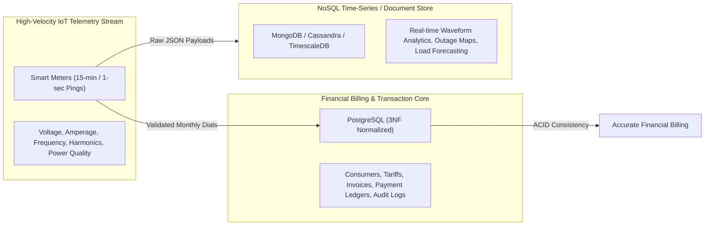

# Relational Database Schema Design & Normalization Proofs
## Assessment Rubric: Schema Design and SQL Implementation (5 Marks)
**Target Database:** PostgreSQL 14+ (pgAdmin 4 Compatible)  
**Database Name:** `electricity_billing_db`  
**Course Outcomes Addressed:** CO1, CO2, CO4, CO6  

---

## 1. Formal Relational Schema Representation

The relational schema of **electricity_billing_db** is formally specified as follows:

- **USERS** ($\underline{\text{user\_id}}$, full_name, email, password_hash, role, status, created_at)
- **CONSUMERS** ($\underline{\text{consumer\_id}}$, consumer_number, *user_id*, full_name, address, phone, email, consumer_category, connection_date, status)
- **SMART\_METERS** ($\underline{\text{meter\_id}}$, meter_number, *consumer_id*, installation_date, meter_type, meter_status, last_communication_at)
- **TARIFF\_SLABS** ($\underline{\text{slab\_id}}$, consumer_category, minimum_units, maximum_units, rate_per_unit, fixed_charge, tax_percentage, effective_from, effective_to)
- **METER\_READINGS** ($\underline{\text{reading\_id}}$, *meter_id*, previous_reading, current_reading, consumption_units, reading_date, reading_type, *recorded_by*, created_at)
- **BILLS** ($\underline{\text{bill\_id}}$, bill_number, *consumer_id*, *meter_id*, *reading_id*, billing_period_start, billing_period_end, units_consumed, energy_charge, fixed_charge, tax_amount, adjustment_amount, total_amount, due_date, bill_status, generated_at)
- **PAYMENTS** ($\underline{\text{payment\_id}}$, *bill_id*, payment_reference, amount_paid, payment_method, payment_date, payment_status, *recorded_by*)
- **AUDIT\_LOGS** ($\underline{\text{log\_id}}$, *user_id*, action, entity_type, entity_id, details, created_at)
- **METER\_TELEMETRY\_DOCUMENTS** *(CO6 Hybrid Semi-Structured Document Store)* ($\underline{\text{telemetry\_id}}$, *meter_number*, recorded_at, payload $\text{[JSONB]}$)

> *(Underlined attributes denote Primary Keys; italicized attributes denote Foreign Keys).*

---

## 2. Normalization Process (1NF $\to$ 2NF $\to$ 3NF)

Normalization ensures minimum data redundancy, prevents update/insertion/deletion anomalies, and enforces referential integrity across the utility billing lifecycle.

### 2.1 Unnormalized Form (UNF) to First Normal Form (1NF)
- **UNF State:** A single legacy electromechanical utility record kept multi-valued contact phone numbers, repeating groups of monthly dial readings, and comma-delimited payment receipts in a single ledger cell.
- **Rules for 1NF:**
  1. Each relation must have a defined primary key.
  2. Each attribute must contain only atomic (indivisible) values.
  3. No repeating groups or nested multi-valued attributes.
- **Decomposition to 1NF:**
  - Removed repeating billing/payment entries into separate relational entities (`meter_readings`, `bills`, `payments`).
  - Flattened phone and contact attributes into discrete atomic columns.
  - Assigned explicit single-attribute surrogate keys (`consumer_id`, `meter_id`, `reading_id`, `bill_id`, `payment_id`).

### 2.2 First Normal Form (1NF) to Second Normal Form (2NF)
- **Condition for 2NF:** The relation must be in 1NF, and all non-key attributes must be fully functionally dependent on the primary key (no partial functional dependencies on composite candidate keys).
- **Resolution:**
  - In a candidate composite relation $\text{R}(\{meter\_number, reading\_date\}, consumer\_name, address, tariff\_rate, current\_reading)$:
    - $\{meter\_number, reading\_date\} \to current\_reading$ (Full functional dependency).
    - $meter\_number \to consumer\_name, address$ (Partial dependency on a subset of the candidate key).
    - $consumer\_category \to tariff\_rate$ (Independent regulatory dependency).
  - Decomposed into distinct relations:
    - `consumers` holds customer attributes dependent solely on $consumer\_id$.
    - `smart_meters` holds hardware attributes dependent solely on $meter\_id$.
    - `meter_readings` captures transactional dial values dependent on $reading\_id$.

### 2.3 Second Normal Form (2NF) to Third Normal Form (3NF)
- **Condition for 3NF:** The relation must be in 2NF, and no non-prime attribute may be transitively dependent on the primary key ($X \to Y$ and $Y \to Z$ where $Z$ is non-key and $Y \not\to X$).
- **Transitive Dependencies Eliminated:**
  - *Transitive Dependency 1 (Consumer Location in Bills):*  
    In an unnormalized bill record: $bill\_id \to consumer\_id \to address, phone$. Storing the consumer's physical address directly in `bills` causes update anomalies when a tenant moves. Resolved by retaining only the foreign key `consumer_id` in `bills`, referencing the canonical profile in `consumers`.
  - *Transitive Dependency 2 (Meter Assignment in Readings):*  
    In meter readings: $reading\_id \to meter\_id \to consumer\_id$. Storing `consumer_id` in `meter_readings` is redundant and introduces inconsistency if a meter is re-assigned. Resolved by joining through `smart_meters`.
  - *Transitive Dependency 3 (Regulatory Tariff Slabs):*  
    $consumer\_id \to consumer\_category \to rate\_per\_unit, fixed\_charge$. Tariff rates change quarterly per government regulatory commission orders. Storing hardcoded rates inside the consumer or bill table creates severe historical billing corruption. Factored out completely into `tariff_slabs` with effective date ranges.

**Conclusion:** All 8 relational tables satisfy Third Normal Form (3NF).

---

## 3. Data Dictionary

### Table 1: `users`
| Column | Data Type | Nullable | Constraints | Description |
| :--- | :--- | :---: | :--- | :--- |
| `user_id` | SERIAL | NO | PRIMARY KEY | Unique surrogate identifier for portal accounts |
| `full_name` | VARCHAR(100) | NO | - | Full legal name of user |
| `email` | VARCHAR(120) | NO | UNIQUE | Login credential and contact email |
| `password_hash` | VARCHAR(255) | NO | - | One-way bcrypt hash (salt rounds = 10) |
| `role` | VARCHAR(20) | NO | CHECK ('ADMIN', 'STAFF', 'CONSUMER') | Role-based authorization permission |
| `status` | VARCHAR(20) | NO | DEFAULT 'ACTIVE', CHECK ('ACTIVE', 'INACTIVE', 'SUSPENDED') | Account standing |
| `created_at` | TIMESTAMPTZ | YES | DEFAULT CURRENT_TIMESTAMP | Account creation timestamp |

### Table 2: `consumers`
| Column | Data Type | Nullable | Constraints | Description |
| :--- | :--- | :---: | :--- | :--- |
| `consumer_id` | SERIAL | NO | PRIMARY KEY | Unique surrogate consumer identifier |
| `consumer_number` | VARCHAR(30) | NO | UNIQUE | Formatted utility account number (e.g., `CON-1001`) |
| `user_id` | INT | YES | REFERENCES `users(user_id)` ON DELETE SET NULL | Linked portal login account |
| `full_name` | VARCHAR(100) | NO | - | Consumer name or registered corporate business |
| `address` | TEXT | NO | - | Physical service delivery address |
| `phone` | VARCHAR(20) | NO | - | Primary telephone contact number |
| `email` | VARCHAR(120) | NO | - | Notification email |
| `consumer_category` | VARCHAR(20) | NO | CHECK ('Residential', 'Commercial', 'Industrial') | Tariff classification category |
| `connection_date` | DATE | NO | DEFAULT CURRENT_DATE | Date electric service connection was activated |
| `status` | VARCHAR(20) | NO | DEFAULT 'ACTIVE', CHECK ('ACTIVE', 'INACTIVE', 'DISCONNECTED') | Supply connection standing |

### Table 3: `smart_meters`
| Column | Data Type | Nullable | Constraints | Description |
| :--- | :--- | :---: | :--- | :--- |
| `meter_id` | SERIAL | NO | PRIMARY KEY | Unique smart meter hardware identifier |
| `meter_number` | VARCHAR(50) | NO | UNIQUE | Manufacturer hardware serial (e.g., `MTR-3001`) |
| `consumer_id` | INT | NO | REFERENCES `consumers(consumer_id)` ON DELETE RESTRICT | Assigned consumer account |
| `installation_date` | DATE | NO | DEFAULT CURRENT_DATE | Field installation timestamp |
| `meter_type` | VARCHAR(40) | NO | DEFAULT 'Digital Smart 3-Phase' | Physical meter hardware model |
| `meter_status` | VARCHAR(20) | NO | DEFAULT 'ACTIVE', CHECK ('ACTIVE', 'INACTIVE', 'MAINTENANCE') | Operating status |
| `last_communication_at`| TIMESTAMPTZ | YES | DEFAULT CURRENT_TIMESTAMP | Last cellular/RF ping received from meter |

### Table 4: `tariff_slabs`
| Column | Data Type | Nullable | Constraints | Description |
| :--- | :--- | :---: | :--- | :--- |
| `slab_id` | SERIAL | NO | PRIMARY KEY | Unique tariff rate slab identifier |
| `consumer_category` | VARCHAR(20) | NO | CHECK ('Residential', 'Commercial', 'Industrial') | Category slab applies to |
| `minimum_units` | NUMERIC(10,2)| NO | DEFAULT 0.00 | Lower threshold of consumption tier (kWh) |
| `maximum_units` | NUMERIC(10,2)| YES | CHECK (maximum_units > minimum_units) | Upper threshold (NULL = unbounded tier) |
| `rate_per_unit` | NUMERIC(10,2)| NO | CHECK (rate_per_unit >= 0) | Price per kWh unit in this slab (₹) |
| `fixed_charge` | NUMERIC(10,2)| NO | DEFAULT 0.00, CHECK (fixed_charge >= 0) | Monthly fixed connection fee |
| `tax_percentage` | NUMERIC(5,2) | NO | DEFAULT 5.00, CHECK (tax_percentage >= 0) | Regulatory electricity duty / tax percentage |
| `effective_from` | DATE | NO | DEFAULT '2024-01-01' | Regulatory commencement date |
| `effective_to` | DATE | YES | - | Expiration date of regulatory order |

### Table 5: `meter_readings`
| Column | Data Type | Nullable | Constraints | Description |
| :--- | :--- | :---: | :--- | :--- |
| `reading_id` | SERIAL | NO | PRIMARY KEY | Unique reading ledger record identifier |
| `meter_id` | INT | NO | REFERENCES `smart_meters(meter_id)` ON DELETE RESTRICT | Meter unit transmitting the reading |
| `previous_reading` | NUMERIC(12,2)| NO | CHECK (previous_reading >= 0) | Cumulative reading at start of billing cycle (kWh)|
| `current_reading` | NUMERIC(12,2)| NO | CHECK (current_reading >= previous_reading) | Cumulative reading at end of billing cycle (kWh) |
| `consumption_units` | NUMERIC(12,2)| NO | CHECK (consumption_units = current - previous) | Net electricity consumed ($Current - Previous$) |
| `reading_date` | DATE | NO | UNIQUE (`meter_id`, `reading_date`) | Date reading was taken / simulated |
| `reading_type` | VARCHAR(20) | NO | CHECK ('Regular', 'Simulated', 'Estimated') | Transmission mode |
| `recorded_by` | INT | YES | REFERENCES `users(user_id)` ON DELETE SET NULL | Staff operator or IoT daemon ID |
| `created_at` | TIMESTAMPTZ | YES | DEFAULT CURRENT_TIMESTAMP | Server recording timestamp |

### Table 6: `bills`
| Column | Data Type | Nullable | Constraints | Description |
| :--- | :--- | :---: | :--- | :--- |
| `bill_id` | SERIAL | NO | PRIMARY KEY | Unique invoice statement identifier |
| `bill_number` | VARCHAR(50) | NO | UNIQUE | Human-readable bill code (e.g., `BILL-202610-1001`) |
| `consumer_id` | INT | NO | REFERENCES `consumers(consumer_id)` ON DELETE RESTRICT | Consumer billed |
| `meter_id` | INT | NO | REFERENCES `smart_meters(meter_id)` ON DELETE RESTRICT | Meter measured |
| `reading_id` | INT | NO | UNIQUE, REFERENCES `meter_readings(reading_id)` | Meter reading instance billed |
| `billing_period_start`| DATE | NO | - | Start date of billing cycle |
| `billing_period_end` | DATE | NO | CHECK (end >= start) | End date of billing cycle |
| `units_consumed` | NUMERIC(12,2)| NO | CHECK (units_consumed >= 0) | Billed kWh volume |
| `energy_charge` | NUMERIC(12,2)| NO | CHECK (energy_charge >= 0) | Progressive tiered slab energy cost |
| `fixed_charge` | NUMERIC(12,2)| NO | CHECK (fixed_charge >= 0) | Monthly fixed infrastructure charge |
| `tax_amount` | NUMERIC(12,2)| NO | CHECK (tax_amount >= 0) | Calculated electricity duty / tax |
| `adjustment_amount` | NUMERIC(12,2)| NO | DEFAULT 0.00 | Prior fuel surcharges, arrears, or credits |
| `total_amount` | NUMERIC(12,2)| NO | CHECK (total_amount >= 0) | Total payable invoice amount ($Energy + Fixed + Tax$)|
| `due_date` | DATE | NO | - | Payment due deadline (15 days after generation) |
| `bill_status` | VARCHAR(20) | NO | CHECK ('Unpaid', 'Partially Paid', 'Paid', 'Overdue') | Current settlement standing |
| `generated_at` | TIMESTAMPTZ | YES | DEFAULT CURRENT_TIMESTAMP | Timestamp invoice was created |

### Table 7: `payments`
| Column | Data Type | Nullable | Constraints | Description |
| :--- | :--- | :---: | :--- | :--- |
| `payment_id` | SERIAL | NO | PRIMARY KEY | Unique financial receipt transaction ID |
| `bill_id` | INT | NO | REFERENCES `bills(bill_id)` ON DELETE RESTRICT | Bill settled by this payment |
| `payment_reference`| VARCHAR(60) | NO | UNIQUE | Gateway or ledger receipt reference |
| `amount_paid` | NUMERIC(12,2)| NO | CHECK (amount_paid > 0) | Monetary sum tendered (₹) |
| `payment_method` | VARCHAR(25) | NO | CHECK ('Cash', 'UPI', 'Card', 'Bank Transfer') | Payment channel |
| `payment_date` | TIMESTAMPTZ | YES | DEFAULT CURRENT_TIMESTAMP | Timestamp payment cleared |
| `payment_status` | VARCHAR(20) | NO | DEFAULT 'SUCCESS', CHECK ('SUCCESS', 'PENDING', 'FAILED') | Settlement confirmation |
| `recorded_by` | INT | YES | REFERENCES `users(user_id)` ON DELETE SET NULL | User who processed payment |

### Table 8: `audit_logs`
| Column | Data Type | Nullable | Constraints | Description |
| :--- | :--- | :---: | :--- | :--- |
| `log_id` | SERIAL | NO | PRIMARY KEY | Sequential audit entry ID |
| `user_id` | INT | YES | REFERENCES `users(user_id)` ON DELETE SET NULL | Actor executing operation |
| `action` | VARCHAR(100) | NO | - | Operation verb (`RECORD_PAYMENT`, `GENERATE_BILL`)|
| `entity_type` | VARCHAR(50) | NO | - | Target table (`bills`, `payments`, `meters`) |
| `entity_id` | INT | YES | - | Target row primary key ID |
| `details` | TEXT | YES | - | Human-readable log narrative |
| `created_at` | TIMESTAMPTZ | YES | DEFAULT CURRENT_TIMESTAMP | Immutable event timestamp |

---

## 4. Course Outcome 6 (CO6): Relational SQL vs. NoSQL Architectural Analysis

### 4.1 The Polyglot Persistence Paradigm in Smart Grids
Modern electrical utilities manage two fundamentally distinct categories of data:



### 4.2 Comparative Architectural Analysis

| Architectural Dimension | Relational Database (PostgreSQL) | Document / Wide-Column NoSQL (MongoDB / Cassandra) |
| :--- | :--- | :--- |
| **Primary Use Case** | Financial billing, progressive slab computation, consumer account master, payment reconciliation. | Ingestion of high-frequency smart meter pings (e.g. 1-second sampled current waveforms). |
| **Data Model** | Rigid, normalized 3NF tables with strict schema and foreign key constraints. | Flexible schema-less BSON/JSON documents or wide-column key-spaces. |
| **Integrity & Consistency**| **ACID** (Atomicity, Consistency, Isolation, Durability). Zero tolerance for ledger discrepancies. | **BASE** (Basically Available, Soft-state, Eventual consistency). Prioritizes high write availability. |
| **Query Complexity** | Multi-table relational `JOIN`s, complex window functions, CTEs, aggregation pipelines. | Primary key lookups, time-bucket range scans, map-reduce aggregations. |
| **Horizontal Scalability** | Vertical scale-up with read replicas and logical partitioning. | Native automatic sharding across distributed clusters. |

### 4.3 PostgreSQL Native JSONB Document Engine Implementation
To address Course Outcome 6 without compromising the relational integrity of the financial billing core, the project demonstrates a hybrid architecture utilizing PostgreSQL's native **`JSONB`** (Binary JSON) and **Generalized Inverted Indexes (GIN)**:

- **Script:** `database/nosql_telemetry_demo.sql`
- **Table:** `meter_telemetry_documents`
- **Schema:**
  ```sql
  CREATE TABLE meter_telemetry_documents (
      telemetry_id SERIAL PRIMARY KEY,
      meter_number VARCHAR(50) NOT NULL REFERENCES smart_meters(meter_number) ON DELETE CASCADE,
      recorded_at TIMESTAMP WITH TIME ZONE DEFAULT CURRENT_TIMESTAMP,
      payload JSONB NOT NULL
  );
  CREATE INDEX idx_telemetry_payload_gin ON meter_telemetry_documents USING GIN (payload);
  ```
- **Capabilities Demonstrated:**
  1. **Polymorphic Storage:** Storing irregular sensor parameters (voltage sags, power factors, ambient temperature, firmware versions) without altering table columns.
  2. **In-Document Field Extraction:** Querying nested JSON attributes using `->>` operators (`payload->'metrics'->>'voltage_rms'`).
  3. **Document Containment Queries:** Utilizing `@>` operators leveraging GIN indexes for sub-millisecond filtering (`payload @> '{"diagnostics": {"firmware_version": "v4.0.0"}}'`).
  4. **Unnesting Arrays:** Using `LATERAL jsonb_array_elements` to dynamically query and isolate irregular device alarms.
