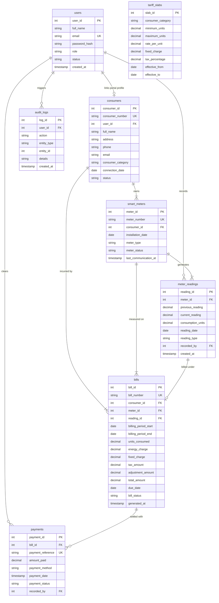

# Entity-Relationship (ER) Modeling
## Electricity Consumption & Smart Meter Billing Database

---

### 1. ER Diagram Overview
The data architecture follows a normalized relational structure centered around consumers, their electrical meter telemetry, billing statements, and payment settlements.

---

### 2. Relationship Cardinalities and Integrity Rules

#### 2.1 Users and Consumers (1 : 0..1)
- Each user account may be linked to at most one electricity consumer. Administrators and Staff operators have no associated consumer profile (`user_id` is unique or nullable).
- If a user account is removed, `ON DELETE SET NULL` preserves consumer billing records.

#### 2.2 Consumers and Smart Meters (1 : 1..N)
- A registered consumer can have one or more smart meters installed across different premises (e.g., residential home and workshop).
- A smart meter must belong to exactly one consumer. Referential integrity is protected via `ON DELETE RESTRICT`.

#### 2.3 Smart Meters and Meter Readings (1 : 1..N)
- A physical meter generates periodic readings over its operational lifetime.
- Unique constraint `uq_meter_reading_date` prevents duplicate recordings for the same meter on the same calendar reading date.

#### 2.4 Meter Readings and Bills (1 : 0..1)
- Every bill corresponds to exactly one confirmed meter reading.
- The `reading_id` column in `bills` carries a **UNIQUE** constraint, guaranteeing that a bill cannot be generated twice for the same meter reading.

#### 2.5 Bills and Payments (1 : 0..N)
- A utility bill may receive multiple partial payments until the outstanding balance drops to zero.
- `payments.bill_id` references `bills.bill_id` with `ON DELETE RESTRICT`.

#### 2.6 Tariff Slabs (Independent Configuration Entity)
- Tariff slabs configure progressive unit rate boundaries and capacity charges by consumer category.
- They are decoupled from transactional tables, allowing regulatory tariff changes over time without altering historical bills.
