# System Requirements Specification (SRS)
## Electricity Consumption & Smart Meter Billing Database

---

### 1. Functional Requirements

#### 1.1 Administrator Role
- **Consumer Management:** Create, view, update, and deactivate consumer records across Residential, Commercial, and Industrial categories.
- **Smart Meter Fleet:** Register hardware units, assign meters to consumers, and toggle operational status (`ACTIVE`, `MAINTENANCE`, `INACTIVE`).
- **Tariff Configuration:** Configure progressive tiered slabs, unit limits ($\text{min} \dots \text{max}$), energy rates, fixed charges, and tax percentages.
- **Billing Oversight:** Trigger billing batch runs, inspect itemized invoices, and cancel inaccurate billing runs.
- **Financial Clearance:** Monitor real-time accounts receivable, outstanding arrears, and revenue collection efficiency.
- **Security & Audit Logs:** Review system-wide operational logs tracking user actions, timestamps, and modified entity IDs.

#### 1.2 Staff Operator Role
- **Consumer Directory:** View consumer lists, installation addresses, and assigned hardware units.
- **Meter Reading Entry & Simulation:** Record periodic dial readings, validate reading sequence ($Current \ge Previous$), or simulate smart IoT readings (+120 to +250 kWh increments).
- **Bill Generation:** Generate bills for confirmed unbilled readings with due dates and adjustments.
- **Payment Collection:** Record counter/digital receipts (Cash, UPI, Card, Net Banking), update bill clearance status, and print customer payment slips.

#### 1.3 Consumer Role
- **Self-Service Dashboard:** View personalized connection profile, meter serial, and current account status.
- **Billing Statement History:** Access current and past utility bills with itemized cost breakdowns.
- **Printable Invoices:** Generate print-ready official electricity bill slips with itemized tier charges.
- **Payment Tracking:** Inspect personal payment history and outstanding balance.

---

### 2. Non-Functional Requirements
- **Data Integrity & Consistency:** Database tables enforce 3NF normalization, foreign key constraints with `ON DELETE RESTRICT`, and domain check constraints.
- **Security:** Passwords encrypted using **bcrypt** (salt factor 10); API endpoints protected by **JSON Web Tokens (JWT)** with HTTP Bearer authorization.
- **Performance:** Database indexing on foreign keys, consumer numbers, meter serials, and billing dates ensuring sub-50ms API response times.
- **Usability & Responsiveness:** Built using React and modern CSS grid/flexbox, fully responsive across desktop, tablet, and mobile screens.
- **Auditability:** Critical events automatically written to `audit_logs` table.

---

### 3. Software and Hardware Requirements

#### 3.1 Software Requirements
- **Operating System:** Windows 10 / 11, macOS, or Linux
- **Relational Database Management System:** PostgreSQL 14+ (PostgreSQL 18 running on port 5432)
- **Database Administration GUI:** pgAdmin 4 (also compatible with MySQL 8.0 / MySQL Workbench)
- **Backend Runtime:** Node.js (v18.0.0 or higher; verified on Node v22.14.0)
- **Backend Framework:** Express.js 4.x
- **Frontend Framework:** React 19 + Vite
- **Data Visualization:** Recharts
- **Icons Library:** Lucide React
- **Code Editor:** Visual Studio Code

#### 3.2 Hardware Requirements
- **Processor:** Intel Core i3 / AMD Ryzen 3 or higher
- **RAM:** Minimum 4 GB (8 GB recommended)
- **Disk Storage:** At least 500 MB free space for application, node modules, and database storage
- **Network:** Localhost TCP loopback on ports 5000 (Backend API) and 5173 (Frontend UI)

---

### 4. Use-Case Diagram

```mermaid
flowchart TD
    subgraph Users ["Actors"]
        Admin["Administrator"]
        Staff["Staff Operator"]
        Consumer["Consumer"]
    end

    subgraph System ["Smart Grid Billing System"]
        UC1["Authenticate & Login (JWT)"]
        UC2["Manage Consumers (CRUD)"]
        UC3["Manage Smart Meters"]
        UC4["Record / Simulate Readings"]
        UC5["Configure Progressive Tariffs"]
        UC6["Generate Electricity Bills"]
        UC7["Record Payments & Settle Dues"]
        UC8["View Analytics & Reports"]
        UC9["Print Official Invoice Slip"]
        UC10["Inspect Security Audit Logs"]
    end

    Admin --> UC1
    Admin --> UC2
    Admin --> UC3
    Admin --> UC4
    Admin --> UC5
    Admin --> UC6
    Admin --> UC7
    Admin --> UC8
    Admin --> UC9
    Admin --> UC10

    Staff --> UC1
    Staff --> UC2
    Staff --> UC4
    Staff --> UC6
    Staff --> UC7
    Staff --> UC8
    Staff --> UC9

    Consumer --> UC1
    Consumer --> UC8
    Consumer --> UC9
```

